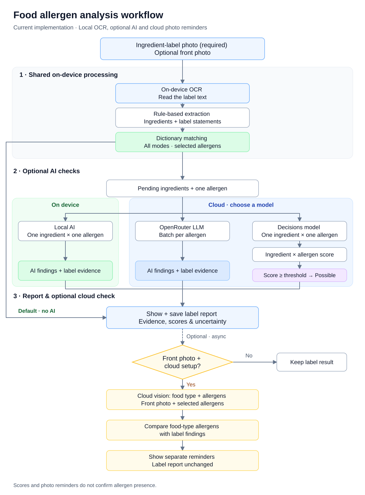

# Allergy Check

Submit a photo of the ingredient list on a packaged food or drink, select the allergens you want to check, and review the findings with their supporting label evidence.

Allergy Check is a native Android hackathon prototype for extracting label text with OCR and analyzing each selected allergen separately. The app organizes OCR text into structured ingredients, maps ingredient synonyms and derivatives to allergen groups, and returns findings with supporting ingredients or label statements. Dictionary matching is the default; local and cloud AI are optional. Unreadable labels, insufficient evidence, and analysis failures are reported with actions to choose another image or retry.

Cloud analysis and an optional front-of-package cross-check are implemented extensions. The front photo helps estimate the food type and compare its common allergens with the ingredient-list findings, adding reminders when something may need another look. See [MoSCoW Scope](#moscow-scope) for implemented features and remaining stretch goals.

Status: hackathon prototype · Default analysis: local Matching mode · Optional AI: local Gemma, OpenRouter LLM, and OpenRouter Decisions

> ⚠️ Safety notice: This is a hackathon prototype and an aid, not a medical device. Never use it as the sole basis for deciding whether a food is safe to eat. People with food allergies should always read the physical label, follow the advice of their medical professional, and contact the manufacturer when in doubt. "No additional reminder" does not mean a product is allergen-free.

## Contents

- [Quick Start: access, requirements, setup, and running](#quick-start)
- [Local and cloud AI configuration](#local-and-cloud-ai-for-ingredient-list-checks)
- [Optional food-type cross-check](#optional-food-type-cross-check)
- [Development and testing](#development-and-testing)
- [Troubleshooting](#troubleshooting)
- [Project structure](#project-structure)
- [MoSCoW scope](#moscow-scope), [workflow](#workflow), and [tech stack](#tech-stack)
- [Allergen coverage](#allergen-coverage) and [limitations](#limitations)

---

## Why This Exists

Ingredient lists are legally required on packaged food, yet people still get caught out:

- Labels are small, dense, and sometimes in a language the reader doesn't know.
- Allergens hide under unfamiliar names, such as *casein*, *albumin*, or *lecithin*.
- Labels can be incomplete, outdated, or wrong, and "may contain" warnings are easy to miss.
- A single source of truth gives no second opinion.

The MVP starts with **a required ingredient-list photo** for allergen analysis. As a Should-have extension, **an optional front-of-package photo** can cross-check the label findings against allergens commonly associated with that type of food. A common-allergen reminder is a prompt to check the label again; it does not establish that the product contains that allergen.

## MoSCoW Scope

These priorities define the hackathon release, with implementation status tracked below. Must-have items form the MVP; Should-have items are extensions; Could-have items are stretch goals; Won't-have items are excluded from this release.

Checked items (`[x]`) are fully implemented in the current app. Unchecked items (`[ ]`) are partially implemented or not yet implemented. Won't-have items remain excluded from this release.

### Must Have

- [x] **Ingredient-list image input:** support taking a photo or uploading an image of the ingredient list.
- [x] **User allergen selection:** provide a built-in allergen list with multiple selections.
- [x] **Saved allergen preferences:** automatically load the user's saved allergen selections on later visits, separate from the built-in selection list required for the MVP.
- [x] **OCR text recognition:** extract the ingredient list and visible allergen statements, including "contains" and "may contain" warnings.
- [x] **Structured ingredient extraction:** organize the recognized text into a structured ingredient list while retaining the original label text and allergen statements as evidence.
- [x] **Ingredient synonym and derivative matching:** map different ingredient names and derivatives to their corresponding allergen groups.
- [x] **Basic allergen analysis:** complete at least one working analysis path, prioritizing local analysis because cloud analysis is a Should-have extension. *Implemented paths: on-device Matching mode, local Gemma AI, OpenRouter LLM, and OpenRouter Decisions; AI findings retain matching evidence.*
- [x] **Findings and evidence display:** show a separate finding for each selected allergen, with the supporting ingredient or label text where available. Distinguish ingredient evidence from precautionary warnings and model inferences.
- [x] **Uncertainty and failure handling:** clearly report unreadable images, insufficient information, and analysis failures, and allow another upload or retry. Do not present a failed or inconclusive check as a clear result.

### Should Have

- [x] **Scan history:** let users review previous scans, extracted ingredients, and analysis results.
- [x] **Cloud AI analysis:** select OpenRouter LLM or OpenRouter Decisions in Settings as an alternative to local processing. Supply your own API key and model ID.
- [x] **Front-of-package cross-check:** optionally send a separate front photo of the same package to an OpenRouter vision model, estimate its food type and common allergens, and show review reminders for selected allergens not identified in the ingredient-list analysis. Reminders never add or confirm an allergen in the label report.

### Could Have

- [ ] **Exploratory unpackaged-food recognition:** estimate the food type from a photo and suggest potentially associated allergens. Clearly state that appearance alone cannot determine the actual ingredients. This is separate from the ingredient-label workflow and is not required for the MVP.
- [ ] **Image preparation tools:** offer cropping and rotation to help users submit a clear ingredient-list image.
- [x] **Additional model options:** OpenRouter Decisions scores each ingredient/allergen pair with a configurable threshold (default 0.5). Scores are uncalibrated model predictions; threshold effectiveness still requires evaluation.

### Won't Have (This Release)

- **AI chat:** no conversational assistant in this release.
- **Food-safety or allergen-free guarantees:** no claim that a product is absolutely safe or guaranteed to be free of allergens.

## Quick Start

### Access and prerequisites

This repository contains an **Android app**. Build and install it on a device or emulator, then open **Allergy Check** from its launcher. There is no web URL, localhost port, backend server, or app account to configure. The fastest first run uses the default **Dictionary matching** mode with an ingredient-label photo; no API key or local AI download is required.

| Requirement | Project configuration / setup |
| --- | --- |
| Android Studio | Use a release that supports the project's Android Gradle Plugin **9.5.1**. Open the `AllergyCheck/` directory as the Gradle project. |
| Gradle JVM | **JDK 25**, as pinned in `AllergyCheck/gradle/gradle-daemon-jvm.properties`. Java source/target compatibility is 11; that is not the JVM used to run Gradle. |
| Gradle | **9.9.0**, supplied by the checked-in wrapper. A separate Gradle installation is unnecessary. |
| Android SDK | **SDK Platform 37** (`compileSdk` and `targetSdk`), Android SDK Build-Tools, and Platform-Tools (`adb`). Install them through Android Studio's SDK Manager and accept the SDK licenses. |
| Android device | **Android 14 / API 34 or newer** (`minSdk = 34`), or an emulator with API 34+. Camera hardware is optional when importing photos. |
| Network | Required for the first Gradle/dependency download, optional Gemma download, and cloud features. The bundled ML Kit OCR and dictionary matching run on-device. |

The pinned build versions are defined in [the app build file](AllergyCheck/app/build.gradle.kts), [version catalog](AllergyCheck/gradle/libs.versions.toml), and [Gradle wrapper configuration](AllergyCheck/gradle/wrapper/gradle-wrapper.properties).

### 1. Get the source

```bash
git clone https://github.com/CaptainRam/nathacks2026.git
cd nathacks2026
```

If you already have a checkout, use its repository directory. All Gradle commands below run from **`nathacks2026/AllergyCheck`**, not the repository root.

### 2. Configure the SDK and JDK

In Android Studio, choose **Open** and select `nathacks2026/AllergyCheck`. In SDK Manager, install the components above; install an emulator system image as well if you are not using a physical phone. In **Settings → Build, Execution, Deployment → Build Tools → Gradle**, select a JDK 25 installation for Gradle. Allow Gradle sync to finish; the wrapper resolves the declared dependencies automatically.

Android Studio normally creates `AllergyCheck/local.properties` with your SDK location. For command-line use, either create that file with the correct absolute path or set `ANDROID_HOME` to your SDK directory. Do not copy someone else's SDK path. Example file contents (choose one and replace the username):

```properties
# macOS example
sdk.dir=/Users/YOUR_USER/Library/Android/sdk
```

```properties
# Linux example
sdk.dir=/home/YOUR_USER/Android/Sdk
```

```properties
# Windows example: forward slashes avoid properties-file backslash escaping
sdk.dir=C:/Users/YOUR_USER/AppData/Local/Android/Sdk
```

`local.properties` is ignored by Git. Set `JAVA_HOME` to your JDK 25 directory and add its `bin` directory to `PATH` when building from a terminal. Add your SDK's `platform-tools` directory to `PATH` to use `adb`. Verify the terminal setup with:

```bash
java -version
adb version
cd AllergyCheck
./gradlew --version
```

The Gradle daemon JVM criteria also request JDK 25 and can provision it through the configured toolchain resolver when network access is available. Preinstalling JDK 25 avoids relying on that download.

### 3. Prepare a device and run

For a **physical phone**, enable Developer options and USB debugging, connect it by USB, and accept the debugging authorization prompt. For an **emulator**, create an API 34+ device in Android Studio's Device Manager and start it. Have a readable English ingredient-label image available on the device; you can drag a JPG/PNG into an emulator and select it through the photo picker.

In Android Studio, select the **app** run configuration, select your device, and click **Run**. If prompted for an activity, choose `com.example.allergycheck.MainActivity`.

Alternatively, from `AllergyCheck/`, build, install, and launch with:

```bash
# Confirm the device appears with status "device"
adb devices

# Build the debug APK
./gradlew :app:assembleDebug

# Install or update the app, then open its main screen
adb install -r app/build/outputs/apk/debug/app-debug.apk
adb shell am start -n com.example.allergycheck/.MainActivity
```

The APK is generated at **`AllergyCheck/app/build/outputs/apk/debug/app-debug.apk`** relative to the repository root. You can also use `./gradlew :app:installDebug` to build and install in one step. Debug builds use the development signing key automatically.

On **Windows PowerShell**, use the same SDK/device setup, but replace `./gradlew` with `.\gradlew.bat`:

```powershell
cd AllergyCheck
.\gradlew.bat :app:assembleDebug
adb install -r app/build/outputs/apk/debug/app-debug.apk
adb shell am start -n com.example.allergycheck/.MainActivity
```

If multiple devices are connected, add `-s DEVICE_SERIAL` to each `adb` command, using the serial shown by `adb devices`, or select a single target in Android Studio.

The manifest also exposes a second launcher entry, **OCR Test**, for OCR/local ingredient-reader diagnostics. Open **Allergy Check** for the complete scan, allergen analysis, and history workflow.

### 4. Complete a first scan

1. Open **Settings → Allergens** (or **Set your allergens** on the scan screen), select at least one allergen, and choose **Save** / **Save preferences**. These selections are restored on later visits.
2. For a first run, keep **Settings → AI model → Detection method → On device → Dictionary matching** selected. If the local-model introduction appears, choose **Later**; basic scanning works without the download.
3. Take or upload a clear ingredient-label photo, including any visible “contains” or “may contain” statement. Grant camera permission if you choose to take a photo. Importing an image uses the system photo picker.
4. Selecting the ingredient photo starts OCR and analysis automatically. Review the extracted ingredients, each selected allergen's finding, supporting evidence, and any warning about unreadable or incomplete text. Choose a clearer photo or retry if processing fails.
5. Optionally configure a [vision model](#optional-food-type-cross-check) and add a separate front photo of the **same product** for cloud reminders. This is optional even when using local ingredient analysis.
6. Open **History** to revisit stored scans. History is stored locally in SQLite with saved label images; records older than **7 days** are pruned during history maintenance. You can delete individual scans or clear the history.

Allergen choices and result-display switches require **Save**. Changing the detection method takes effect immediately; cloud fields require **Save** before use. Model downloads and deletions also apply immediately.

## Development and testing

Run these commands from `AllergyCheck/` (use `.\gradlew.bat` on Windows):

```bash
# Local JVM unit tests; no Android device required
./gradlew :app:testDebugUnitTest

# Android lint
./gradlew :app:lintDebug

# Instrumented tests; requires a connected API 34+ device/emulator
./gradlew :app:connectedDebugAndroidTest
```

HTML reports are generated under `AllergyCheck/app/build/reports/`: `tests/testDebugUnitTest/index.html`, `lint-results-debug.html`, and `androidTests/connected/` respectively. Unit tests still need the Android SDK and Gradle dependencies. Use a test device/emulator for instrumented tests: they exercise and modify app settings, photos, and history.

Real inference/photo tests are **opt-in** and are skipped in the default device test run:

| Test class | Additional setup / instrumentation arguments |
| --- | --- |
| `LocalAiModelIntegrationTest` | Install Gemma in the app; set `runLocalModelSmoke=true`. |
| `FoodCrossCheckLiveTest` | Save cloud credentials and a vision model; provide `runFoodCrossCheckLive=true`, `labelPhotoPath`, and `frontPhotoPath`. `preflightOnly=true` runs OCR without cloud traffic. |
| `RealPhotoUiTest` | Provide `runRealPhotoUi=true`, `labelPhotoPath`, `frontPhotoPath`, and `replacementFrontPhotoPath`. Set `runLiveCloud=true` and configure cloud settings to make actual provider calls. |

For example, after installing the local model, run only the real local-AI smoke test:

```bash
./gradlew :app:connectedDebugAndroidTest \
  -Pandroid.testInstrumentationRunnerArguments.class=com.example.allergycheck.LocalAiModelIntegrationTest \
  -Pandroid.testInstrumentationRunnerArguments.runLocalModelSmoke=true
```

Other instrumentation arguments use the same `-Pandroid.testInstrumentationRunnerArguments.NAME=VALUE` format. Photo paths must be readable by the app on the test device. Cloud tests read credentials from app settings; do not put API keys in commands or logs. Live cloud requests may consume provider credits.

See [test cases and prepared-photo requirements](docs/TEST_CASES.md), [coverage reconciliation](docs/TEST_COVERAGE_RECONCILIATION.md), and the [manual TalkBack checklist](AllergyCheck/TALKBACK_CHECKLIST.md). Those documents include historical test evidence; a passing software test does not establish allergen-detection accuracy.

## Troubleshooting

| Symptom | What to check |
| --- | --- |
| `./gradlew` not found | Change into `AllergyCheck/`; the wrapper is not in the repository root. On Windows use `.\gradlew.bat`. |
| `Permission denied` for `gradlew` | On macOS/Linux run `chmod +x gradlew` from `AllergyCheck/`, then retry. |
| Java/Gradle JVM error | Verify JDK 25, terminal `JAVA_HOME`, Android Studio's Gradle JDK, and the pinned daemon JVM criteria. Java source level 11 does not mean Gradle should run on JDK 11. |
| `SDK location not found` | Set `sdk.dir` in `AllergyCheck/local.properties` or set `ANDROID_HOME` to your installed SDK. |
| SDK Platform 37 missing / dependency resolution fails | Install SDK Platform 37 and the required SDK tools, accept licenses, and check access to the Gradle distribution, Google Maven, Maven Central, and Gradle Plugin Portal. `--offline` works only after all needed artifacts have been cached. |
| Android Studio cannot sync the AGP version | Use an IDE release compatible with AGP 9.5.1; retain the repository's pinned wrapper and plugin versions. |
| `adb` not found / device `unauthorized` or `offline` | Add SDK `platform-tools` to `PATH`, start the emulator or reconnect the phone, and accept its USB debugging prompt. Use `adb devices` to verify. |
| `INSTALL_FAILED_OLDER_SDK` | Use Android API 34 or newer. |
| Camera permission denied or no camera | Allow camera access in Android app settings, or import a label photo instead. |
| No allergen results / unreadable label | Select and save allergens, then use a sharp, well-lit English ingredient list rather than only the package front. |
| Local AI model missing / download fails | Use **Settings → AI model → On device → Local AI model** to download/retry; check network, free storage, and the system download service. Dictionary matching remains available. |
| Cloud check fails | Save the API key and the model ID for the selected mode. Check credentials, credits/quota, model support, and network. For rate limits, reduce **Parallel requests** and respect the displayed retry time. |
| Front-photo cross-check fails | Save a separate image-capable **Food-type vision model ID (optional)** and shared API key. Check that both photos show the same product and that the label has a readable result. |

## Project structure

```text
nathacks2026/
├── README.md
├── AllergyCheck/                  # Android Studio / Gradle project
│   ├── app/build.gradle.kts       # Application ID, SDK levels, dependencies
│   ├── app/src/main/
│   │   ├── AndroidManifest.xml   # Permissions and launcher activities
│   │   ├── java/com/example/allergycheck/
│   │   │   ├── ocr/              # On-device label reading and preparation
│   │   │   ├── ingredients/      # Extraction and local model management
│   │   │   ├── analysis/         # Matching, reports, and local/cloud AI
│   │   │   ├── crosscheck/       # Optional front-photo vision check
│   │   │   └── history/          # SQLite storage, images, retention
│   │   └── res/raw/allergen_dictionary.json
│   ├── app/src/test/             # JVM unit tests
│   ├── app/src/androidTest/      # Device/emulator tests
│   ├── gradle/                   # Version catalog, wrapper, JVM criteria
│   └── TALKBACK_CHECKLIST.md      # Manual accessibility verification
└── docs/                         # Workflow diagram and test documentation
```

## Local and Cloud AI for Ingredient-List Checks

The main scan uses shared on-device OCR, deterministic ingredient structuring, and synonym/derivative matching. **Settings → AI model → Detection method** selects the processing location and mode. **On device → Dictionary matching** is the default and does not require a downloaded model or API key.

| Mode | Processing and setup |
| --- | --- |
| Dictionary matching (Matching mode) | Local rules and the built-in dictionary; the default local detection method. |
| Local AI | On-device Gemma 3 1B through MediaPipe. Download the model in Settings before use. |
| OpenRouter LLM | Cloud chat completions batch the structured ingredients still needing AI checks for one selected allergen per request. Save an OpenRouter API key and a chat model ID in `provider/model` format. |
| Decisions model | OpenRouter's native `/api/alpha/decisions` API. Save a compatible Decisions model ID and a threshold from 0 to 1 (default 0.5). This is a separate model setting from the chat model. |

### Set up Local AI (optional)

1. Open **Settings → AI model → Detection method → On device**.
2. Under **Local AI model**, review **Details** and the linked Gemma terms, then choose **Download**. The pinned Gemma 3 1B task is **554,661,243 bytes (about 555 MB)**; leave room for the download and app/runtime data.
3. Keep a network connection available until the status is **Installed** / ready for offline use. The app verifies the downloaded file's size and SHA-256 before installation. Downloading the model does not change the detection method.
4. Select **Local AI** under **Detection method** and scan an ingredient label. Inference runs on-device and checks ingredient/allergen pairs sequentially; performance depends on the device. If inference cannot complete, review the partial result or switch to **Dictionary matching**.

The same downloaded model is used by the separate **OCR Test** AI ingredient reader. The model is not included in the APK. You can remove it with **Delete** in Settings and download it again later. Model download/deletion needs no **Save** action.

### Set up cloud ingredient analysis (optional)

1. Obtain an OpenRouter API key for your account and an available model ID in `provider/model` format. No key or default model ID is bundled with the app.
2. Open **Settings → AI model → Detection method → Cloud** and choose **OpenRouter LLM** or **Decisions model**.
3. Under **Cloud connection**, enter the **OpenRouter API key**. For LLM mode, fill in **OpenRouter model ID** with a chat model. For Decisions mode, fill in the separate **Decisions model ID** with a model supported by that API, and set **Flag threshold (0–1)** (default **0.5**). Chat and Decisions model IDs are independent settings.
4. Set **Parallel requests** to a positive whole number (default **1**) and choose **Save** at the bottom of Settings. Start with 1; increase it only if your provider limits permit. Local AI remains sequential.
5. Return to the scan screen and select a label photo. If configuration is missing or a request fails, use the displayed settings/retry action; matching evidence remains available in the partial report.

Cloud fields apply only after **Save**, while selecting the detection method applies immediately. No `.env` file, build-time secret, or server deployment is required. API keys are stored in app-private preferences and excluded from Android backup and device transfer. Re-enter the key on a new installation/device; keep it out of Git, screenshots, and logs.

**Every ingredient-list AI request targets only one selected allergen.** Ingredient/allergen pairs already flagged by the dictionary skip AI. Local AI checks **one remaining ingredient per request** to reduce hallucinations, using a fresh session for each ingredient/allergen pair. Decisions also scores **one ingredient per request** so each flag can be attributed to its original ingredient. The OpenRouter cloud LLM receives the **remaining structured ingredients in one batch per selected allergen** and returns findings associated with the supplied ingredients. Parent ingredient names and bracketed sub-ingredients stay separately identifiable. Other selected allergens, the raw full label, and photos are not included in ingredient-classification requests. Label statements such as “contains” and “may contain” remain distinct and are checked locally. The separate OCR Test screen's LLM ingredient reader is not used for classification.

AI replies contain only a validated verdict or Decisions score, never generated ingredient names. The report attaches every risk, uncertain result, and unchecked item to its original ingredient text. Existing matching positives cannot be removed by AI. AI findings are shown as possible sources, and Decisions scores at or above the configured threshold are flagged; these scores are model predictions, not calibrated probabilities or proof of presence. Even when “show not detected” is off, flagged or unchecked ingredients remain visible.

Missing configuration offers a link to AI settings. Request failures, malformed answers, and 90-second model timeouts preserve the best partial report, mark unprocessed ingredients for manual review, and offer retry. Empty/unreadable input remains inconclusive; no ingredients are invented to fill an empty result. Headingless and short text are checked as far as the extracted evidence permits.

Cloud LLM mode sends the structured ingredients still needing AI checks and one selected allergen to OpenRouter over HTTPS; Decisions sends one such ingredient and one selected allergen per request. API keys are stored in app-private preferences and excluded from Android backup and device transfer. Model IDs are deliberately left empty until configured; there is no bundled key. See the official [OpenRouter API documentation](https://openrouter.ai/docs/api_reference/overview) and [Decisions guide](https://openrouter.ai/docs/guides/community/multimodal-decisions).

## Optional food-type cross-check

In **Settings → AI model → Cloud connection**, enter the shared **OpenRouter API key** and a separate image-capable **Food-type vision model ID (optional)**, then choose **Save** at the bottom of Settings. This setup is independent of Matching, Local AI, OpenRouter LLM and Decisions for ingredient analysis; you can leave ingredient detection set to **On device**. The model IDs start empty; selecting a text-only model or an unavailable model produces a retryable cross-check failure.

After adding a required ingredient-list photo, optionally take or import one front photo of the **same product**. Selecting the optional front photo starts the cloud check once the ingredient analysis is available; when the label result is already shown, the check starts after loading the front photo. The photo controls explain this upload before selection. The check sends the front photo and the selected allergen IDs/names to OpenRouter over HTTPS. The ingredient-list photo, OCR text and label report are not included in this vision request.

The model estimates the food type and commonly associated allergens from the selected list. When a common allergen was not identified in the ingredient-list results, the main result summary includes a review reminder and the affected allergen rows show **Review needed**, even when “show not detected” is off. If the label result was otherwise “not detected”, its main card uses a warning colour and **Review the ingredient label** headline. Expanding a reminder row shows the original label status and the separate food-type estimate. Existing ingredient, “contains”, “may contain”, and possible findings keep their original label evidence. Removing or replacing the front photo clears its live reminders. The food-type estimate cannot add an ingredient finding, confirm an allergen’s presence, or alter the stored ingredient report.

Completed cross-checks are saved with the same scan in history. Opening its detail shows the saved review summary and allergen reminders without sending another cloud request or requiring the original front photo. If the detail is already open when the check finishes, it updates automatically. History retains the last completed check when you remove a live photo, retry unsuccessfully, leave the page or start another scan. A later successful check of the same ingredient result replaces the saved reminders, including clearing a previous reminder when no mismatch remains. Earlier history entries without a saved cross-check continue to show their ingredient-label results.

Without a front photo, the ingredient scan proceeds normally. An unreadable food type, invalid model reply, missing configuration or network error leaves the ingredient result available and offers the appropriate retry or settings action. Check the photo is of the same product: the app cannot establish that from separate images. No extra reminder does not establish that the product is allergen-free.

## Workflow



[Open the updated diagram](docs/workflow-updated.drawio.svg) · [PNG preview](docs/workflow-updated.png) · [Original diagram](docs/workflow.drawio.svg). Both SVGs contain editable diagrams.net / draw.io data. The updated diagram follows the current implementation: all modes share local extraction and dictionary matching; the default path reports directly, while optional AI checks only pending ingredients. The original planned diagram is preserved. The [MoSCoW Scope](#moscow-scope) defines MVP commitments.

### MVP path (Must Have)

1. **Allergen selection and preferences:** select one or more allergens from the built-in list, save the selections, and automatically load them on later visits.
2. **Image input:** take or upload an ingredient-list photo containing any visible allergen statements.
3. **OCR:** extract the ingredient list and visible "contains" or "may contain" text. Report unreadable input or processing failures and let users upload another image or retry.
4. **Ingredient extraction:** organize OCR text into structured ingredients, retaining the original text and allergen statements for evidence. The main scan structures ingredients deterministically and expands bracketed sub-ingredients; a separate OCR Test screen also provides a local LLM ingredient reader.
5. **Normalization and local analysis:** map ingredient synonyms and derivatives to allergen groups in every mode. Matching mode reports these findings directly; optional local AI checks remaining ingredient/allergen pairs. Label statements retain local matching evidence. Report insufficient evidence or inconclusive findings explicitly.
6. **Report:** show the extracted ingredients and a separate finding for each selected allergen, along with supporting ingredients or label text where available and any uncertainty. Keep precautionary warnings distinct from ingredient evidence and model inferences.

### Extensions

- **Cloud analysis (Should Have):** batch the structured ingredients still needing AI checks for an OpenRouter cloud LLM, one selected allergen per request, and return findings tied to the original ingredients as an alternative to local AI.
- **Front-photo cross-check (Should Have):** estimate the food type from an optional front photo of the same product, use model knowledge to estimate common allergens, and compare those estimates with the ingredient-list findings for the selected allergens. Add review reminders for common allergens not identified in the label analysis. Without a front photo, proceed directly to the report.
- **Scan history (Should Have):** let users revisit previous scans, extracted ingredients, and analysis results.
- **Additional models (Could Have):** offer the Decisions model as an additional cloud option, producing ingredient/allergen scores and flags at a configured threshold. Scores are model predictions, not confirmed ingredient presence.
- **Image preparation and unpackaged-food exploration (Could Have):** add cropping or rotation, and separately explore food-type recognition without an ingredient label. Unpackaged-food exploration does not replace the required label input in the MVP path.

### Processing location

Settings selects Local (Matching mode or Local AI) or Cloud (OpenRouter LLM or Decisions). OCR, main-scan ingredient structuring, and dictionary matching run on-device in every mode. AI skips ingredient/allergen pairs already flagged by the dictionary. Cloud LLM classification batches the remaining structured ingredients for one selected allergen per request; Decisions sends one remaining ingredient and one selected allergen per request. Local AI also checks one remaining ingredient and one selected allergen per request using the downloaded Gemma model; download requires internet, and subsequent local inference runs offline.

## Tech stack

The current implementation uses the following components. Dependency versions are pinned in [the Gradle version catalog](AllergyCheck/gradle/libs.versions.toml).

| Component | Priority | Implementation / status |
| --- | --- | --- |
| Android app and results UI | Must | Java, Android XML layouts, AndroidX, and Material Components; per-allergen findings, evidence, uncertainty, and retry actions |
| Image input and shared OCR | Must | CameraX camera capture, Android photo picker, and bundled ML Kit Latin text recognition **16.0.1** |
| Allergen selection and preferences | Must | JSON-backed multi-select list; local `SharedPreferences` for selections and result-display options |
| Ingredient structuring | Must | Deterministic Java extraction in the main scan, retaining label evidence; optional local LLM reader in OCR Test |
| Allergen normalization and matching | Must | Built-in JSON dictionary of ingredient synonyms, derivatives, ambiguous terms, and exclusions |
| Local allergen-analysis LLM | Must, optional mode | Gemma 3 1B via MediaPipe Tasks GenAI **0.10.35**; one ingredient/allergen pair at a time, with local label-statement evidence retained |
| Scan history | Should | Android SQLite with app-private label images and **7-day** retention |
| Cloud LLM | Should | OpenRouter HTTPS chat completions; pending structured ingredients batched for one selected allergen per request |
| Optional food-type cross-check | Should | Separate OpenRouter vision model; front-photo estimates produce review reminders only |
| Image preparation tools | Could | User-facing cropping and rotation tools are not implemented |
| Cloud Decisions model | Could, implemented | Native OpenRouter Decisions endpoint; ingredient/allergen scores with configurable model ID and threshold |
| Unpackaged-food recognition | Could | Not implemented; separate from the required ingredient-label workflow |

## Possible outcomes

| Result | Meaning |
| --- | --- |
| Ingredient-list finding | Label analysis identifies a potential allergen, with the supporting ingredient or label text where available. |
| Precautionary label warning | The label includes a statement such as "may contain" for a selected allergen. Present it separately from ingredients explicitly listed. |
| Not identified in analyzed text | No evidence for a selected allergen was identified in the analyzed text. This is not an allergen-free or food-safety guarantee. |
| Inconclusive | The label is unclear, evidence is insufficient, or findings cannot be reliably compared. Ask the user to review the label or provide a clearer image. |
| Processing failure | OCR or analysis could not complete. Show a failure message and allow another upload or retry; do not substitute a negative finding. |
| Food-type reminder (Should) | A common allergen estimated from the optional front photo was not identified in the ingredient-list analysis. Check the physical label and any "may contain" statement. |
| No additional reminder (Should) | The optional front-photo cross-check found no additional common allergens to flag. This does not establish that the product is allergen-free. |
| Threshold flag (Could) | A Decisions-model score meets the configured threshold for an allergen. This is a model prediction, not proof of presence. |

## Example Output

Illustrative only; these examples show intended formats, not implemented behavior.

### MVP local analysis (Must Have)

```text
Selected allergens: milk, soy, tree nuts
Analysis mode: local

Extracted ingredients: sugar, cocoa, skimmed milk powder, soy lecithin
Recognized allergen statement: Contains milk and soy

Findings for selected allergens:
  milk      — identified; ingredient: skimmed milk powder;
              label statement: Contains milk and soy
  soy       — identified; ingredient: soy lecithin;
              label statement: Contains milk and soy
  tree nuts — not identified in the analyzed label text

Review the physical label. A "not identified" finding does not establish
that the product is allergen-free or safe to eat.
```

### Optional front-photo cross-check (Should Have)

After the ingredient analysis, the optional cross-check can show an independent reminder from the front photo:

```text
Product type estimated from front photo: chocolate hazelnut spread
Common allergens estimated from food type: milk, soy, tree nuts

REMINDER: Tree nuts are commonly associated with this food type but were
not identified in the ingredient-list analysis. Check the physical label
and any "may contain" statement. This estimate does not confirm their presence.
```

Cloud LLM analysis is an implemented Should-have alternative. The implemented Could-have Decisions option adds ingredient/allergen scores and threshold flags; its detection accuracy and score calibration still require evaluation.

## Allergen Coverage

The current selection interface provides **10 built-in allergen groups** with multiple selections, loaded from the same dictionary used by the matcher:

milk, eggs, peanuts, tree nuts, soy, wheat/gluten, sesame, fish, shellfish, and mustard.

This is not a complete regional allergen list. Celery, lupin, and sulphites are not currently offered as dedicated selections. Gluten-containing grains are included in the combined **Wheat/Gluten** group, and molluscs are included in **Shellfish**, rather than offered as separate selections.

Examples of the synonym mapping:

| Ingredient as printed | Maps to |
| --- | --- |
| casein, whey | milk |
| albumin | egg |
| lecithin (when soy-derived) | soy |
| semolina | wheat |

Each user-selected allergen is evaluated separately. The report states which allergens were checked; unselected allergens are not assessed. Personal selections are saved locally. Model scores are an additional output in Decisions mode.

The allergens the app checks for, and the vocabulary used to recognise each one, live in
`AllergyCheck/app/src/main/res/raw/allergen_dictionary.json`. Editing that file is all it takes to
add a term or an allergen — the pickers and the matcher both read it, so they cannot drift apart.
Matching is **English-only**: a label panel in another language is kept as text but recognises
nothing.

> Allergen lists and naming rules differ by region (for example the US, EU, UK, and Canada).

## Limitations

Please read these before relying on any output:

- OCR errors affect later analysis. Blurry, curved, reflective, or non-standard labels may be misread or partly missed. The MVP must show unreadable-input and failure states.
- Ingredient structuring and allergen analysis can make mistakes, including missing ingredients or inferring unsupported allergens.
- Decisions scores depend on the model and threshold. They are not established probabilities or proof that an allergen is present; score interpretation and thresholds require evaluation.
- The Should-have front-photo cross-check supports a food-type estimate. Common-allergen reminders cannot establish the exact recipe, hidden ingredients, processing aids, or cross-contamination.
- The MVP requires a packaged-food ingredient label. Could-have unpackaged-food recognition is exploratory: appearance alone cannot determine actual ingredients or allergen presence.
- Missing or conflicting findings need review. No flagged allergen or additional reminder does not prove a product is safe.
- OCR, main-scan ingredient structuring, and Dictionary matching run locally. Local AI requires an initial model download; cloud ingredient analysis and optional front-photo reminders require a connection.
- Regional rules vary. Labeling laws and allergen lists differ by country.
- Not medical advice. This project is no substitute for professional medical guidance.

## Tips for Good Photos

- Photograph the ingredient list straight on, not at an angle.
- Use even lighting and avoid glare on glossy packaging.
- Make sure the full ingredient list and any allergen statement are legible.
- For the optional cross-check, provide a separate front photo of the same product with its name and food type visible.

## Team

- Roddy 
- Eddie
- Annas
- Alvin

Built during NatHacks 2026, from Nov 6th to the 9th.
